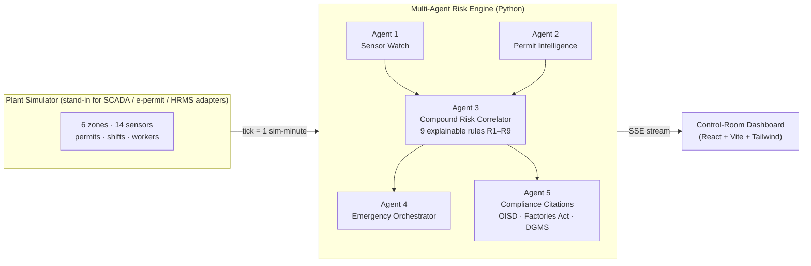

# SURAKSHA — Industrial Safety Intelligence Platform

**AI-Powered Industrial Safety Intelligence for Zero-Harm Operations**

> A multi-agent AI system that fuses gas sensors, pressure readings, work permits, shift schedules and worker presence into one explainable risk score per plant zone — detecting deadly **combinations** of conditions that no single-sensor alarm can see, **hours before** the accident, and acting on them automatically.

---

## The problem

India records **6,500+ fatal workplace accidents every year** (DGFASLI, FY2023). In January 2025, eight workers died in a coke-oven explosion at Visakhapatnam Steel Plant — a facility with functioning gas detectors, permit-to-work controls and SCADA. The warning data existed. **No intelligence layer connected the readings to the fact that people were working inside that zone during a shift change.**

Conventional alarms are independent tripwires: they fire when one sensor crosses one line — after the hazard already exists. Real fatalities are built from several *individually tolerable* conditions stacking up. That is the gap SURAKSHA closes.

## The solution



- **Agent 1 — Sensor Watch:** levels *and* least-squares trends per sensor ("rising" is the early warning).
- **Agent 2 — Permit Intelligence:** cross-checks live permits against zone conditions (hot work × flammable gas; confined-space entry × abnormal atmosphere).
- **Agent 3 — Compound Risk Correlator:** fuses all signals through 9 weighted rules into a 0–100 zone score with a full reason trace — every alert explains itself.
- **Agent 4 — Emergency Orchestrator:** on critical — evacuation order, team notifications, evidence snapshot, and an auto-generated regulator-style incident report.
- **Agent 5 — Compliance:** cites the exact OISD / Factories Act 1948 / DGMS provisions for every fired rule.

The safety core is **deliberately deterministic** — explainable, auditable, certifiable, testable — because safety regulators cannot act on black boxes. An optional free-tier LLM polishes report prose only, with a hard template fallback.

## Results (simulated benchmark — fully reproducible)

| Metric | SURAKSHA | Single-sensor baseline |
|---|---|---|
| Sub-threshold compound incidents detected (n=10) | **9/10** | **0/10** — never alarms at all |
| Median detection lead, escalating incidents (n=20) | **210 min** | — (defines t=0) |
| Canonical Vizag-replay lead time | **229 min (3.8 h)** | alarm at t=394 |
| False positives, normal operations (n=20 runs) | **0** | 0 |

All numbers are generated by deterministic, seeded simulation — reproduce them with one command (`scripts/run_benchmark.py`). The scenario generator and test suite (30 tests, including a regression test that pins the demo behaviour) ship in this repo.

## Quickstart (Windows / any OS with Python 3.11+ and Node 18+)

```bash
# Backend — terminal 1
cd backend
python -m venv .venv
.venv/Scripts/pip install -r requirements.txt      # Linux/macOS: .venv/bin/pip
.venv/Scripts/python -m uvicorn app.main:app --port 8000

# Dashboard — terminal 2
cd dashboard
npm install
npm run dev
# open http://localhost:5173  → pick "Vizag Replay", speed 5×, watch
```

Run the tests: `cd backend && .venv/Scripts/python -m pytest tests -v`
Run the benchmark: `backend/.venv/Scripts/python scripts/run_benchmark.py`

## Repository map

```
backend/app/simulator/   plant model + scripted scenarios (normal_day · near_miss · vizag_replay)
backend/app/agents/      the five agents; correlator.py holds rules R1–R9
backend/app/main.py      FastAPI: SSE /stream + REST (/scenario, /sim/speed, /report/latest)
backend/tests/           30 pytest tests incl. the detection-lead regression guarantee
dashboard/src/           control-room UI: heatmap, WHY panel, alerts, sparklines, permits, agent log
scripts/run_benchmark.py the benchmark behind every number above
docs/                    architecture notes + full metrics
```

## Scalability

The plant is **data, not code** — zones, sensors, thresholds and rule weights live in JSON config. Onboarding a new facility means writing its config and connecting adapters (OPC-UA/SCADA, e-permit, HRMS) that emit exactly the data shapes the bundled simulator emits. The engine evaluates a 6-zone plant in microseconds per tick.

## Team & tooling

Built by **Madhav Sharma** using open-source software (FastAPI, React, Vite, Tailwind, Recharts, pytest). Development was **AI-assisted** (Claude as pair programmer) — the problem selection, system design, rule semantics, and every product decision are my own, and I can walk through any line of this repo. No paid APIs are used anywhere in the system.

## License

MIT — see [LICENSE](LICENSE).
