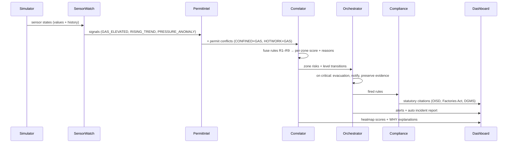

# SURAKSHA — Architecture

## System overview

```mermaid
flowchart LR
    subgraph SIM["Plant Simulator (digital stand-in for IoT/SCADA)"]
        CFG[plant_config.json<br/>6 zones · 14 sensors] --> TICK[Tick Engine<br/>1 tick = 1 sim-minute]
        SCN[Scripted Scenarios<br/>normal_day · near_miss · vizag_replay] --> TICK
    end

    TICK -->|sensor values, permits,<br/>shifts, workers| PIPE

    subgraph PIPE["Multi-Agent Risk Engine (deterministic + explainable)"]
        A1[Agent 1<br/>Sensor Watch<br/>thresholds & trends] --> A3
        A2[Agent 2<br/>Permit Intelligence<br/>permit × condition conflicts] --> A3
        A3[Agent 3<br/>Compound Risk Correlator<br/>rule fusion R1–R9 → zone score 0-100] --> A4
        A3 --> A5[Agent 5<br/>Compliance<br/>OISD / Factories Act citations]
        A4[Agent 4<br/>Emergency Orchestrator<br/>evacuation · notify · evidence · report]
    end

    A4 -->|incident report<br/>markdown + optional LLM polish| API
    A5 -->|citations| API
    A3 -->|zone risks + reasons| API

    subgraph API["FastAPI"]
        SSE["/stream (SSE, 1 payload/tick)"]
        REST["/scenario /sim/speed /state /report"]
    end

    SSE --> DASH
    REST <--> DASH

    subgraph DASH["React Control-Room Dashboard"]
        KPI[KPI Header + Detection Lead]
        MAP[Plant Risk Heatmap<br/>SVG, explainable WHY panel]
        FEED[Alert Feed + Incident Report]
        PANELS[Sensors · Permits · Agent Activity]
    end
```

## Agent pipeline (each tick)

## Design principles

1. **Compound > single-signal.** The correlator's weights make dangerous
   *combinations* score critically even when every individual reading is
   sub-alarm — because that's how real industrial fatalities happen.
2. **Explainable by construction.** Every alert carries the exact rules that
   fired (R1–R9), human-readable reasons, and statutory citations — what a
   safety officer needs to act, and a regulator needs to audit.
3. **Deterministic core, LLM at the edge.** Risk scoring is rule-based (no
   hallucination risk in the safety path); an optional free-tier LLM only
   polishes report prose, with a hard template fallback.
4. **Config-driven scalability.** Zones, sensors, and thresholds live in
   `plant_config.json` — the same engine runs any plant layout; scenarios are
   data, not code.

## Replacing the simulator with reality

The simulator emits the same shape of data a real plant would: OPC-UA/Modbus
gateways (sensors), e-permit systems (permits), HRMS shift rosters (workers).
Swapping the simulator for those adapters is an integration task — the agent
pipeline, API, and dashboard are unchanged.
